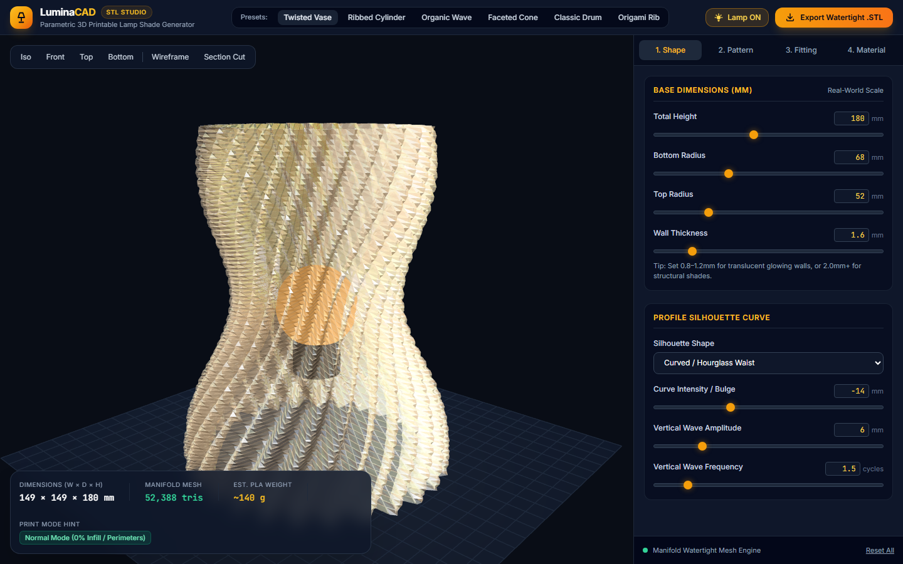

# LuminaCAD — 3D Printable Lamp Shade Studio 💡🖨️

[](https://varunaditya0012.github.io/luminacad/)
[](https://threejs.org/)
[](https://tailwindcss.com/)
[](LICENSE)

> **A browser-native, parametric 3D CAD studio for designing, visualizing, and exporting custom watertight lamp shades for 3D printing.**



---

## 🚀 Live Demo

**Experience the studio live:** [**https://varunaditya0012.github.io/luminacad/**](https://varunaditya0012.github.io/luminacad/)

---

## ✨ Features

- **📐 Full Parametric Geometry Engine**
  - Control height, bottom radius, top radius, wall thickness, and silhouette curves (Conical, Hourglass, Bulbous, Teardrop, Harmonic Sine Wave).
  - Surface rib patterns: Smooth Sinusoidal Ribs, Sharp Origami Pleats, Fluted Curves, and Knurled Diamonds with helical twist angles up to ±360°.

- **💡 Realistic Translucent Material & Lighting Simulation**
  - Real-time internal bulb glow simulation with physically-based translucency (MeshPhysicalMaterial with transmission and subsurface diffusion).
  - Selectable color temperatures: **2200K Edison**, **3000K Warm White**, and **5000K Daylight**.
  - Dynamic filament swatches: Warm Natural PLA, Cool White, Amber Sunset, Terracotta, Ice Blue, and Matte Charcoal.

- **🔌 Integrated Standard Socket Mounts**
  - Parametric spider ring and strut mount generator supporting standard electrical hardware:
    - **E14 Euro (29mm)**
    - **E27 Euro (40mm)**
    - **US E26 (35mm)**
  - Options for Top spider (pendant lamp), Bottom spider (table lamp), solid base disc, or vase mode (open).

- **📊 Real-Time Slicer Telemetry HUD**
  - Live dimensional bounding box ($W \times D \times H$ mm).
  - Watertight manifold triangle counter.
  - Estimated filament consumption and PLA weight calculation ($\sim 1.24\,\text{g/cm}^3$).
  - Intelligent slicer recommendations (Spiral Vase Mode, Normal Mode 0% Infill, or Upside-Down Print).

- **✂️ CAD Inspection Tools**
  - Interactive cross-section clipping plane to inspect wall thickness, internal ribs, and socket hardware fit.
  - Wireframe overlay mode and camera presets (Isometric, Front, Top, Bottom).

- **💾 Watertight Binary .STL Exporter**
  - Client-side, high-speed binary `.stl` file generation.
  - Automatic coordinate frame transformation from Three.js $Y$-up to 3D Slicer $Z$-up, ready for **Bambu Studio**, **PrusaSlicer**, **OrcaSlicer**, and **UltiMaker Cura**.

---

## 🛠️ Technology Stack

- **Graphics & Rendering**: [Three.js r128](https://threejs.org/) (WebGL, MeshPhysicalMaterial, OrbitControls, Clipping Planes)
- **Styling & UI**: [Tailwind CSS](https://tailwindcss.com/)
- **Typography**: Inter & JetBrains Mono via Google Fonts
- **Export Engine**: Custom Native JavaScript `ArrayBuffer` & `DataView` Binary STL generator
- **Deployment**: GitHub Pages (Zero build step, 100% client-side)

---

## 🏃 Run Locally

Simply clone and open `index.html` in any modern web browser:

```bash
git clone https://github.com/varunaditya0012/luminacad.git
cd luminacad
# Open in browser directly or with any local server
npx serve .
```

---

## 📜 License

This project is licensed under the MIT License - see the [LICENSE](LICENSE) file for details.
